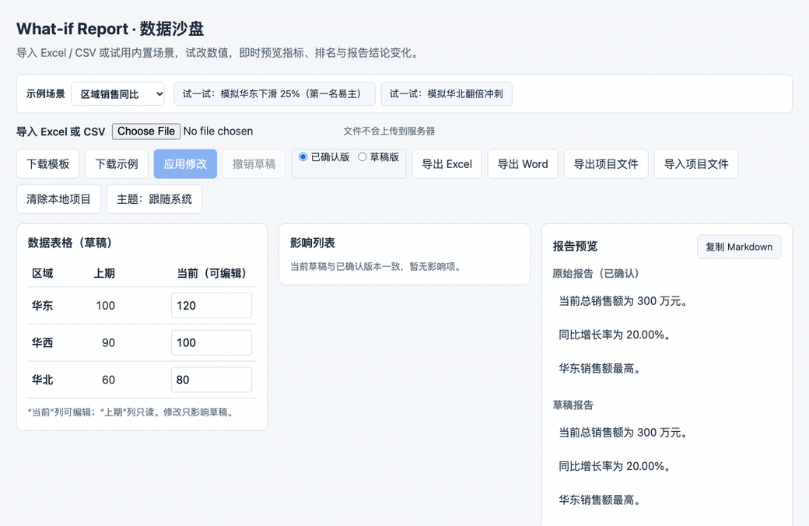

# What-if Report

[](https://github.com/XianingY/cooffice/actions/workflows/ci.yml)
[](https://xianingy.github.io/cooffice/)
[](LICENSE)
[](package.json)

**English** · [简体中文](README.md)

A **local-first, optional-cloud** full-stack what-if analysis workbench: import an Excel/CSV spreadsheet or pick a built-in scenario, tweak numbers in a sandbox draft, inspect deterministic metric/ranking/narrative impacts with source-cell highlighting, and export clean Excel/Word files or copy a Markdown summary — without ever overwriting your original file or sending data to a server unless you opt in.

> **Try it live right now (zero setup, 100% in-browser, zero network requests):**
> **👉 [https://xianingy.github.io/cooffice/](https://xianingy.github.io/cooffice/)**
> Click a **"试一试"** preset button in the top scenario bar to see live impact diffing, ranking flips, and source-cell highlighting in 3 seconds.



## Architecture

```text
Desktop Shell (Electron 36)
   ├── Main Process   Embedded Fastify API, native menus/dialogs, PathAuthorizer, window state, recent files
   └── Preload        Sandboxed contextBridge exposing window.desktop + webUtils.getPathForFile
        │ same-origin http://127.0.0.1:<port>/
        ▼
Browser / Electron Renderer (React 19 + Vite 6)
   ├── src/core       Pure TypeScript domain logic (metrics, impacts, reports, scenario templates, AI numeric guard)
   ├── src/adapters   xlsx / csv / docx / storage / ai / wps
   ├── src/api        Typed fetch client (single-flight 401 refresh, idempotent retries, timeouts)
   ├── src/auth       In-memory access token + HttpOnly refresh cookie
   └── src/components 3-column workbench + DemoBar + collapsible optional cloud panel
        │ same-origin /api/
        ▼
Fastify 5 + SQLite (better-sqlite3 v13, WAL)
   ├── Auth           scrypt hashing, JWT + atomic refresh rotation, reuse detection, RBAC
   ├── Projects       CRUD, baseline/draft separation, optimistic locking, pagination/search
   ├── Reports        Server-authoritative metrics, report blocks, and charts
   ├── Realtime       SSE project-change stream with per-user connection cap & graceful shutdown
   └── Ops            Health/ready probes, OpenAPI/Swagger, structured audit logs, rate limits, CSP
```

## Quick Start

### One-Command Setup

```bash
npm run setup -- --web    # Browser-only local-first mode
npm run setup -- --full   # Web + Fastify API + SQLite migration
npm run setup             # Everything (Web + API + Electron desktop)
```

Or launch directly in **GitHub Codespaces** using the included [.devcontainer/devcontainer.json](.devcontainer/devcontainer.json).

### Local-Only Browser Mode (Zero Config)

```bash
npm ci
npm run dev
```

Visit `http://localhost:5173`. Zero outbound network requests are made.

### Full-Stack Mode (Web + API)

```bash
npm run setup -- --full
npm run dev:full          # web :5173 + api :3001
```

Create `.env.local` to connect the web UI to the local API:

```text
VITE_API_BASE_URL=http://127.0.0.1:3001
```

### Docker Compose

```bash
cp .env.example .env      # Set a strong random JWT_SECRET
docker compose up -d --build
```

Visit `http://localhost:8080`. See [docs/deployment.md](docs/deployment.md).

### Desktop App (Offline-Capable Electron)

```bash
npm --prefix desktop install
npm run desktop:stage
npm run desktop:start
npm run desktop:dist      # Build dmg / zip / nsis / AppImage installers
```

See [docs/desktop.md](docs/desktop.md).

## Key Capabilities

- **Instant Demo Scenarios**: Built-in Sales, Department Budget, and Product Revenue templates with 1-click what-if presets.
- **Real Spreadsheet Import**: `.xlsx`/`.xls` (`Sales` sheet), `.csv` (guided column mapping with currency symbols, thousands separators, and scientific notation), and portable `.whatif`/`.json` project files with automatic schema migration.
- **Deterministic Core & Source Tracing**: Pure TypeScript calculations with click-to-highlight evidence linking every conclusion back to exact cells.
- **Flexible Export**: Switch between confirmed baseline and draft exports for `.xlsx`, `.docx`, or 1-click Markdown copy.
- **Opt-In Guarded AI Polish**: Disabled by default (zero network). When enabled, a deterministic numeric & unit guard rejects any response that alters a number or unit; keys stay strictly in dialog memory.
- **Optional Cloud Sync & Desktop Shell**: Full auth/project API with SSE updates, plus an offline-first Electron app hardened with Electron fuses, per-launch session tokens, and session-scoped path authorization.

## Verification

```bash
npm run verify            # lint + typecheck + unit tests + browser E2E + web/server build
npm run test:e2e:full     # Full-stack Playwright E2E (real Fastify + SQLite)
npm run desktop:test      # Electron main-process typecheck + unit tests
npm run test:e2e:desktop  # Real Electron E2E
```

## Contributing

Contributions are warmly welcome! Check out:

- Open [**Good First Issues**](https://github.com/XianingY/cooffice/issues?q=is%3Aissue+is%3Aopen+label%3A%22good+first+issue%22)
- [CONTRIBUTING.md](CONTRIBUTING.md) — includes a **5-minute walkthrough for adding a new scenario template** in `src/core/templates.ts`
- [CODE_OF_CONDUCT.md](CODE_OF_CONDUCT.md) and [SECURITY.md](SECURITY.md)

## License

[MIT](LICENSE) © 2026 What-if Report contributors
