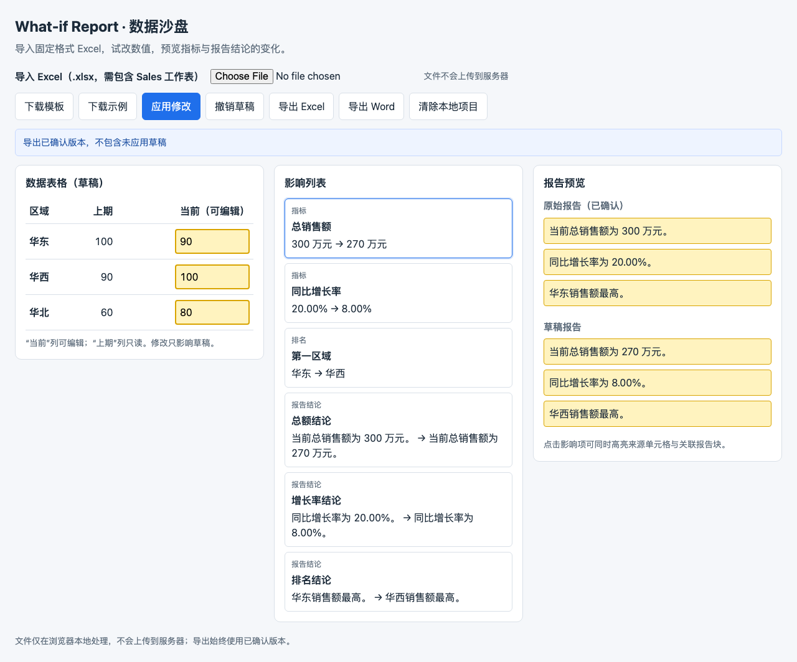

# What-if Report（数据沙盘）

一个**本地优先、可选云端**的全栈工具:导入固定格式的 Excel/CSV,在浏览器中试改数据,查看指标和报告结论的变化,确认后导出新的 Excel 和 Word。登录后可把项目保存到 SQLite 后端,跨设备继续工作;不登录也能完成全部本地功能。

> **项目状态:v1.0.0 稳定版本。** 前端、后端、认证、数据库、API、实时通知、CI 与容器部署均已实现并通过本地与端到端验证。



## 架构

```text
浏览器 (React 19 + Vite)
   ├── src/core        纯 TypeScript 领域逻辑(无 DOM/React/第三方格式依赖)
   ├── src/adapters    xlsx / csv / docx / storage / ai / wps
   ├── src/api         类型化 API 客户端(401 自动刷新、5xx 重试)
   ├── src/auth        内存会话 + HttpOnly 刷新 Cookie
   └── src/components  三栏编辑器 + 可选云面板
        │ 同源 /api/
        ▼
Fastify 5 + SQLite(better-sqlite3, WAL)
   ├── 认证:注册/登录/刷新轮换/登出/RBAC
   ├── 项目:CRUD + 草稿编辑/应用/撤销 + 乐观锁
   ├── 报告:服务端权威指标、报告块、图表
   ├── 实时:SSE(项目变更)
   └── 运维:健康检查、OpenAPI、审计、限流、安全头
```

## 快速开始

### 纯本地模式(零配置)

```bash
npm ci
npm run dev
```

打开 `http://localhost:5173`。此模式下不发起任何网络请求,云面板显示配置提示。

### 全栈模式

```bash
npm ci
(cd server && npm ci)
cp server/.env.example server/.env          # 开发占位值即可
npm run server:migrate
npm run dev:full                            # web :5173 + api :3001
```

要启用前端云功能,创建 `.env.local`:

```text
VITE_API_BASE_URL=http://127.0.0.1:3001
```

### 容器部署

```bash
cp .env.example .env                        # 设置强随机 JWT_SECRET
docker compose up -d --build
```

访问 `http://localhost:8080`。详见 [部署指南](docs/deployment.md)。

## 验证命令

```bash
npm run typecheck       # 前端类型
npm test                # 全部 Vitest(前端+后端,224 项)
npm run test:e2e        # 前端浏览器测试(13 项)
npm run test:e2e:full   # 全栈浏览器测试(真实后端 + SQLite)
npm run build           # 前端生产构建
npm run server:build    # 后端编译
npm run verify          # 顺序执行全部门禁
```

## 功能

| 能力 | 说明 |
|---|---|
| 导入 | `.xlsx`(Sales 工作表)或 `.csv`(引导式列映射);10 MiB/1000 行上限;公式与非法数值拒绝 |
| 试改 | 仅「当前」列可编辑;指标、影响列表、报告与图表即时更新 |
| 来源定位 | 点击影响项高亮来源单元格与报告块 |
| 配置 | 报告块显示切换与排序;随本地存储与项目文件保存 |
| 导出 | 已确认版本导出 `.xlsx`/`.docx`;Word 库按需加载 |
| 本地恢复 | 版本化 localStorage(v1/v2 自动迁移至 v3);二次确认清除 |
| 云端 | 注册/登录、项目保存/打开、草稿与确认分离、实时变更通知 |
| 安全 | scrypt 密码哈希、JWT 短令牌、刷新令牌哈希与家族轮换、HttpOnly Cookie、RBAC、限流、安全头 |
| 运维 | 健康检查、OpenAPI/Swagger、结构化日志与请求 ID、审计日志 |

## 文档

- [用户指南](docs/user-guide.md)
- [开发指南](docs/development.md)
- [部署指南](docs/deployment.md)
- [WPS 集成验证说明](docs/wps-integration-notes.md)
- [路线图](ROADMAP.md) · [变更记录](CHANGELOG.md) · [安全说明](SECURITY.md) · [贡献指南](CONTRIBUTING.md)

## License

[MIT](LICENSE) © 2026 What-if Report contributors
