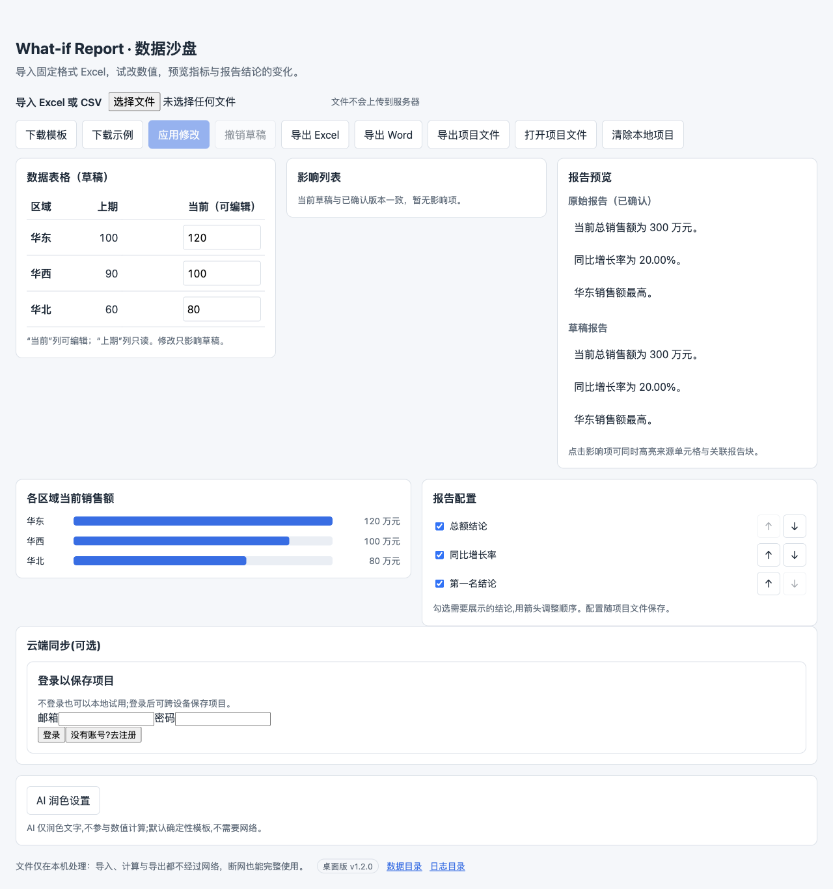

# 桌面应用（Electron）

桌面版把同一套 React 界面与 Fastify/SQLite 后端打包成一个可安装的原生应用：双击即可使用，无需浏览器、无需 Node、无需 Docker，断网也能完整工作。



## 为什么是 Electron

| 方案 | 结论 | 原因 |
|---|---|---|
| Electron + 内嵌 Fastify | **采用** | 后端是 Node/Fastify + better-sqlite3，可直接在主进程内运行，认证、SQLite、SSE 全部原样复用；原生菜单、对话框、快捷键都由 Node 侧驱动 |
| Tauri + 侧车 Node | 未采用 | 需要额外分发一份 Node 运行时做 sidecar，安装包与启动链路都更复杂，收益仅是体积 |
| 纯 Webview 壳 | 未采用 | 无法内嵌后端，登录/项目库等功能会退化成「必须自己起服务」 |

代价是安装包体积（约 110 MB dmg，安装后约 300 MB），换来的是零外部依赖与功能完整。

## 运行时结构

```text
What-if Report.app/Contents/Resources/
├── app.asar                 Electron 主进程 + preload（仅壳代码）
├── web/                     React 构建产物（由内嵌服务器托管）
└── server/
    ├── dist/                Fastify 编译产物（ESM）
    ├── node_modules/        生产依赖，better-sqlite3 已按 Electron ABI 重编译
    └── package.json         "type": "module"
```

启动顺序：

1. 主进程解析资源目录（打包态用 `process.resourcesPath`，开发态用 `desktop/build/`）。
2. `startEmbeddedServer()` 在 `127.0.0.1` 上挑一个空闲端口启动 API，静态托管 `web/`。
3. 生成/复用每安装独立的 JWT 密钥（`<userData>/data/jwt-secret.key`，权限 0600）。
4. 打开窗口并加载 `http://127.0.0.1:<port>/`。
5. 退出时先关 HTTP 服务、再关数据库。

### 三道本地防线

| 防线 | 做法 | 挡住什么 |
|---|---|---|
| 只绑定回环 | 服务器只监听 `127.0.0.1` 的随机端口 | 局域网与其它的机器 |
| 每次启动的会话令牌 | 32 字节随机值，`/api/*` 必须带 `x-whatif-session`（`timingSafeEqual` 比较） | 同机上扫描端口、试图直接读写项目库的其它程序 |
| 渲染进程沙箱 | `contextIsolation` + `nodeIntegration:false` + 权限全拒 + 固定的 IPC 白名单 | 页面内被注入的脚本拿到系统能力 |

令牌经同步 IPC 交给渲染进程（而不是命令行参数——`ps` 能看到 argv），随后由 API 客户端与 SSE 请求统一附加。浏览器与容器部署不设置令牌，守卫根本不会安装。

同源托管是关键设计：`fetch`、Cookie、SSE 都走同一个 origin，因此**不需要任何 CORS 例外**，也不存在 `file://` 下的存储与相对路径问题。Web 版与桌面版共用同一份前端产物，桌面模式仅通过 preload 注入的 `window.desktop` 启用原生能力。

### 数据与日志位置

| 平台 | 路径 |
|---|---|
| macOS | `~/Library/Application Support/What-if Report/` |
| Windows | `%APPDATA%\What-if Report\` |
| Linux | `~/.config/What-if Report/` |

其中 `data/whatif.db`（账号与云项目）、`logs/main.log`、`logs/server.log`（JSON Lines，单文件 2 MB 轮转）、`state/window-state.json`、`state/recent-files.json`。菜单「帮助 › 打开日志目录」与页脚按钮可直接定位。

## 桌面能力

| 能力 | 说明 |
|---|---|
| 原生菜单 | 文件/编辑/视图/窗口/帮助；撤销、剪切、复制、粘贴全部走系统 role，输入框里 ⌘C/⌘V 正常 |
| 快捷键 | ⌘O 打开、⌘S 保存（已打开文件就地覆盖）、⌘I 导入表格、⌘E/⇧⌘E 导出 Excel/Word |
| 原生对话框 | 打开/保存项目、导入 Excel/CSV 都走系统对话框；导出后提示路径并可「在访达中显示」 |
| 最近打开 | 最多 8 条，文件被删除时自动剔除 |
| 窗口状态 | 位置、尺寸、最大化状态持久化；显示器拔掉后自动重新居中，不会跑到屏幕外 |
| 单实例 | 再次启动会聚焦已有窗口，并把命令行传入的项目文件交给当前实例 |
| 文档关联 | 命令行或 Finder「打开方式」传入 `.json` 时自动载入；未保存改动在关闭按钮上显示圆点 |
| 外链安全 | `window.open`、非本应用跳转一律拦截并交给系统浏览器；相机/麦克风/定位/录屏权限全部拒绝 |
| 更新检查 | 「检查更新…」读取 `WHATIF_UPDATE_FEED`（仅 https），未配置时如实提示而非假装已检查 |
| 崩溃可诊断 | 渲染进程日志经 IPC 落到主进程日志文件，用户反馈问题时可直接提供日志目录 |
| 升级可回滚 | schema 有变更前用 SQLite 在线备份 API 快照到 `backups/`，保留最近 5 份；失败只告警不阻塞启动 |
| 能力收敛 | Electron fuses 关闭 `runAsNode`/`NODE_OPTIONS`/CLI inspect/额外 file 权限，开启 Cookie 加密、asar 完整性校验 |

## 本地开发

```bash
npm --prefix desktop install     # 首次：Electron 与打包工具
npm run desktop:stage            # 构建前端+后端，并把 API 依赖按 Electron ABI 安装/重编译
npm run desktop:start            # 启动桌面应用
```

`desktop:stage` 产出 `desktop/build/{web,server}`，开发态与打包态加载的是**同一份**运行时产物，避免「开发能跑、打包就崩」。首次会执行一次 `npm ci` + `node-gyp` 编译 better-sqlite3（约 1–3 分钟），之后由 `desktop/build/server/.stamp` 命中缓存。

> 为什么不让 Electron 直接复用 `server/node_modules`：better-sqlite3 是原生模块，按 Electron ABI 编译后系统 Node 就加载不了，`npm --prefix server test` 会直接失败。隔离一份依赖是唯一干净的解法。

调试：`WHATIF_DEVTOOLS=1 npm run desktop:start` 打开开发者工具；`WHATIF_USER_DATA_DIR=/tmp/wifr` 可换一个临时 profile（自动化测试即用此方式）。

## 打包与分发

```bash
npm run desktop:dist                       # 当前平台的安装包
node desktop/scripts/package.mjs --dir     # 只产出未打包的 .app，用于冒烟
node desktop/scripts/package.mjs --mac arm64
```

产物在 `desktop/release/`：macOS 为 `.dmg` + `.zip`（均带 blockmap 用于增量更新），Windows 为 NSIS 安装器，Linux 为 AppImage。

- **图标**：`npm run desktop:icons` 用纯 Node 重新生成 `build-resources/icon.{png,icns,ico}`（脚本自带矢量栅格化，无第三方图像库）。
- **签名**：默认使用本机钥匙串里的证书；正式分发前设置 `CSC_LINK`/`CSC_KEY_PASSWORD`。
- **公证**：设置 `APPLE_ID`/`APPLE_APP_SPECIFIC_PASSWORD`/`APPLE_TEAM_ID` 后 electron-builder 会自动公证；未配置时日志会明确写出 `skipped macOS notarization`。
- **架构**：`electron-builder.yml` 默认同时产出 arm64 与 x64；交叉构建 x64 需要对应架构的编译工具链，CI 里建议分矩阵跑。

### 自动更新

`electron-updater` 已接入，但默认不指向任何服务器（`publish.url` 是占位域名）。要启用：

1. 把 `desktop/release/` 里的 `latest-mac.yml`、`.dmg`、`.zip`、`.blockmap` 上传到任意静态站点；
2. 用 `WHATIF_UPDATE_FEED=https://你的域名/releases` 启动，或直接改 `electron-builder.yml` 的 `publish.url`；
3. 「检查更新…」会比对版本并在有新版时提示下载地址。当前不做静默自动安装，避免在未签名的开发构建上误触发。

## 验证

```bash
npm run verify:desktop              # 主进程类型检查 + 41 项单测
npm run test:e2e:desktop            # 7 项真实 Electron 端到端
WHATIF_E2E_NO_SANDBOX=1 npm run test:e2e:desktop   # 受限沙箱/容器内需要关闭 Chromium 沙箱
```

端到端用例驱动的是真实 Electron 进程：窗口与页面渲染、`window.desktop` 桥、内嵌 API 的 origin、编辑/应用草稿、经 IPC 落盘、刷新后本地草稿仍在、profile 目录生成 SQLite 与密钥。

当前基线：**桌面单测 45 项、Electron E2E 11 项、根 Vitest 312 项、后端 Vitest 120 项、浏览器 E2E 13 项、全栈 E2E 2 项**全部通过。

E2E 覆盖：窗口启动与页面渲染、`window.desktop` 桥、内嵌 API 的 origin、经令牌守卫的注册、草稿编辑与应用、未保存标记、菜单指令回传、经 IPC 落盘、刷新后本地草稿仍在、profile 目录生成、窗口位置跨重启恢复。

## 常见问题

| 现象 | 处理 |
|---|---|
| 启动后窗口空白 | 看 `logs/main.log` 是否有 `api listening`；没有则是端口/依赖问题，重新执行 `npm run desktop:stage` |
| `NODE_MODULE_VERSION` 不匹配 | 原生模块是给系统 Node 编译的，重新跑 `npm run desktop:stage`（会按 Electron ABI 重编译） |
| 终端里 Electron 报 `bad option: --remote-debugging-port` | 环境里有 `ELECTRON_RUN_AS_NODE=1`，用 `env -u ELECTRON_RUN_AS_NODE` 启动 |
| 沙箱/容器内 Chromium 起不来 | 加 `--no-sandbox`（本仓库 E2E 用 `WHATIF_E2E_NO_SANDBOX=1` 控制），生产环境不要关 |
| 忘记密码 | 本地库单人使用：删掉 `data/whatif.db` 会清空账号与云项目，本地草稿仍保留在渲染进程存储里 |
| 升级后打不开 | 先看 `data/backups/` 里迁移前的快照，把最新一份复制回 `data/whatif.db` 即可回滚 |
| `Error loading V8 startup snapshot` | 不要开启 `loadBrowserProcessSpecificV8Snapshot` fuse，它需要配套的自定义快照文件 |

## 已知边界

- 未做文件类型注册（双击 `.json` 不会唤起本应用），但支持「打开方式」与命令行传入。
- 未做深色主题：界面为单一浅色调，主进程固定 `themeSource = "light"`，避免深色窗框与浅色文档割裂。
- 拖拽文件到窗口不会导入（请用「导入 Excel 或 CSV」）；列入 [路线图](../ROADMAP.md)。
- 安装包未签名分发时，macOS 首次打开需右键「打开」；正式分发请走签名 + 公证流程。
